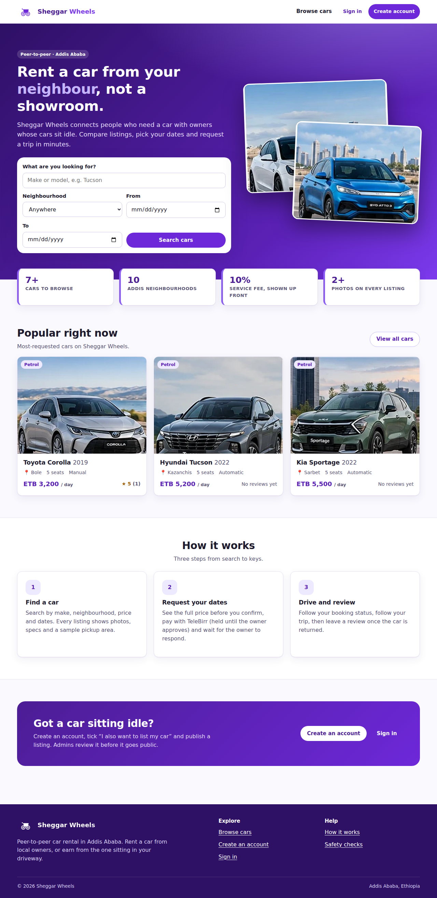
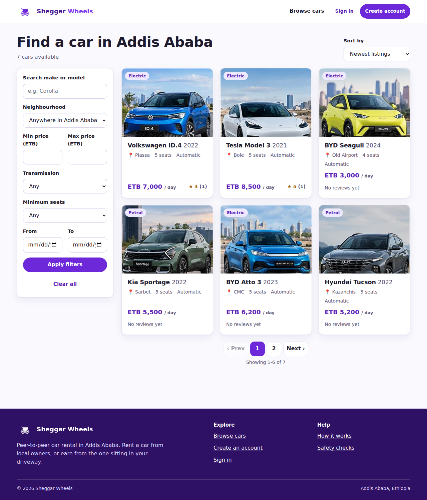
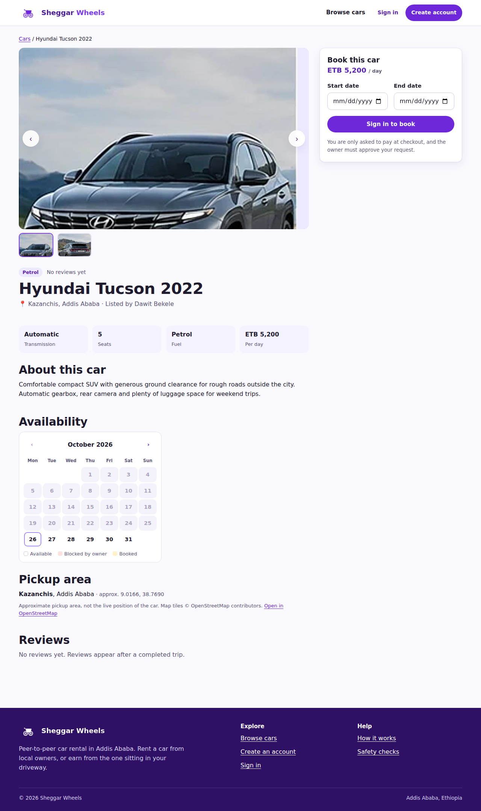
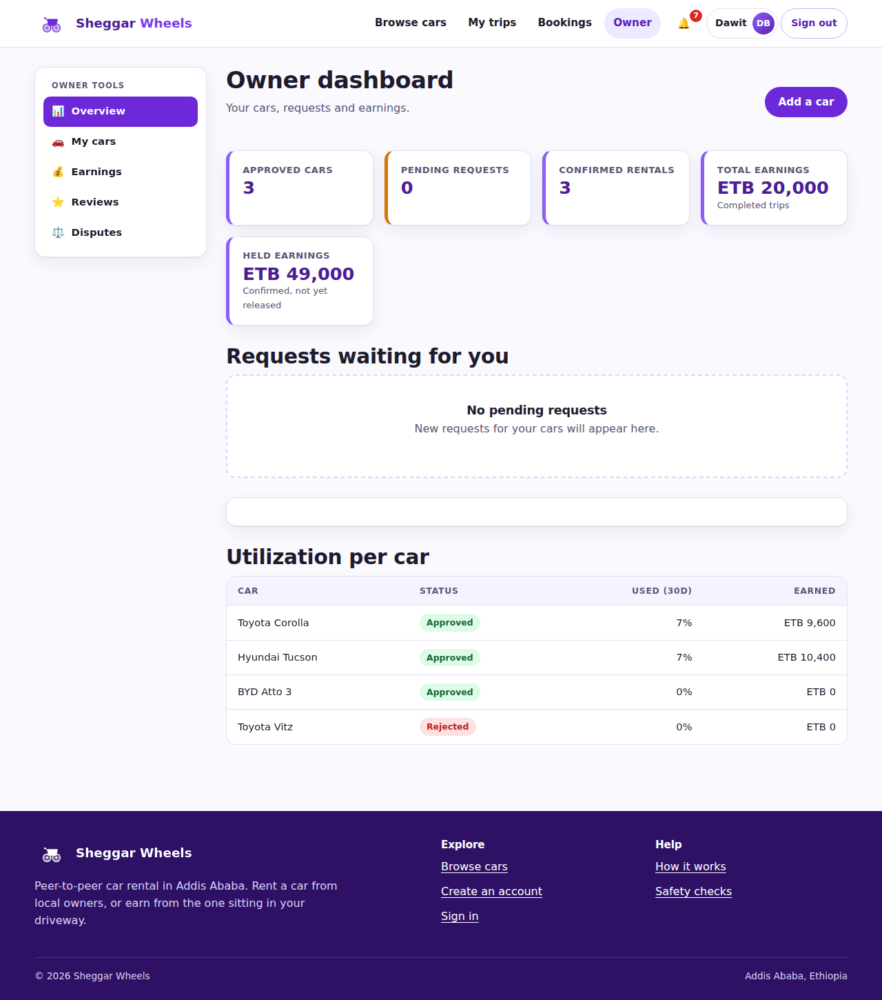
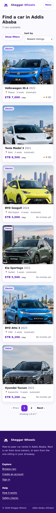
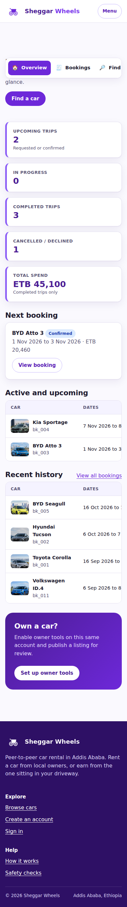

# Sheggar Wheels

A peer-to-peer car rental marketplace for **Addis Ababa**

> *"I built Sheggar Wheels, a responsive peer-to-peer car rental frontend with role-aware navigation, car search, booking state management, owner tools, and an admin dashboard."*

**Live URL:**  
**Everything is a simulation.** There is no database, no real payment, no real authentication and no GPS. The interface is written as a normal product (no "demo" banners or badges). Two short notes remain on purpose because they are factually needed: payments are simulated (checkout page) and the trip tracker is a route preview, not GPS.

## Screenshots


| Home | Catalogue | Car detail |
|---|---|---|
|  |  |  |

| Owner dashboard | Catalogue (mobile) | Renter dashboard (mobile) |
|---|---|---|
|  |  |  |

## Features

**Visitor / Renter** – browse, search, filter, sort and paginate cars (filters live in the URL, e.g. `/cars?neighbourhood=Bole&sort=price-asc`); car detail with photo gallery (2 real photos per car), a 1200×630 share image (Open Graph) per car, specs, availability calendar and a Leaflet map with a non-map fallback; live price breakdown; safe sign-in redirect; mock TeleBirr checkout with a fake transaction reference; receipt; booking history with status filter, pagination and CSV export; cancel eligible bookings; raise an issue during a trip; simulated trip tracker; add **one review per booking** after a completed trip (inline on the booking page, or "Write review" in the booking list) and see the owner's reply; in-app notification panel.

**Owner** – dashboard (cars, requests, confirmed rentals, earnings, utilization, Recharts chart + accessible table); create/edit/deactivate own listings with demo photo picker; availability calendar; approve/decline requests, start/complete rentals and follow an in-progress rental on the (simulated) trip tracker; earnings page with CSV export; reply to reviews; view and reply to disputes.

**Admin** – platform metrics and charts; approve/reject listings (with reason); view users and suspend/reinstate; all bookings; review and resolve disputes with notes; mock platform commission and CSV reports; publish announcements.

**Cross-cutting** – role-aware navigation and nested layouts, route groups, access-blocked screen for suspended users, empty/loading/error/success states, malformed-storage recovery banner, keyboard-accessible forms/tables/dialogs/calendar, 44px touch targets, visible focus, reduced-motion support, responsive down to 360px.

## Tech stack

Next.js 15 (App Router) · React 19 · plain CSS design system (purple theme) · SWR · Recharts · Leaflet · `next/image`, `next/font`, Metadata API, sitemap/robots. **No database, no Tailwind, no TypeScript.**

## Run it

Requires Node.js 18.18+ (20+ recommended).

```bash
npm install
npm run dev        # http://localhost:3000
npm run build      # production build
npm start          # serve the production build
```

`next/font/google` downloads the font at build time, so the **first build needs internet access**. The font is then self-hosted by Next.js.

Copy `.env.example` to `.env.local` if you want canonical URLs, sitemap and Open Graph URLs to use your deployed domain (`NEXT_PUBLIC_SITE_URL`). Everything works without it.

## Sample accounts (no passwords)

Choose one on `/signin`, or type the email.

| Account | Email | Roles | Notes |
|---|---|---|---|
| Dawit Bekele | `dawit@example.com` | renter + owner | owns 4 cars (3 approved, 1 rejected) |
| Hanna Tesfaye | `hanna@example.com` | renter + owner | owns Sportage, Seagull, Tesla; has a pending request and an open dispute |
| Samuel Kebede | `samuel@example.com` | renter + owner | owns VW ID.4 and a pending Wuling listing |
| Meron Alemu | `meron@example.com` | renter | booking history in every state |
| Yonas Girma | `yonas@example.com` | renter | an in-progress trip (try the tracker, raise an issue) |
| **Selam Admin** | `admin@example.com` | admin | **seeded administrator** – the only way to get admin access |
| Kebede Worku | `kebede@example.com` | renter (suspended) | to see the access-blocked screen |

Public sign-up only creates `renter` (optionally `renter + owner`) accounts. It can never create an admin.

### An 8-minute walkthrough

1. Visitor: `/cars` → filter by Bole, sort by price → open a car → pick dates → **Sign in to book** (note the `?next=` return path).
2. Sign in as **Meron** → checkout → **Confirm and pay** → receipt.
3. Sign out, sign in as the car's **owner** → Owner → approve the request → *Start rental* → *Track trip* → *Mark returned*.
4. Back as **Meron** → open the completed booking → *How was your trip?* → rate and publish (one review per booking; the form turns into your review) → export bookings CSV.
5. As **Dawit** → add a car → sign in as **Selam Admin** → Listings → approve → see it in the catalogue.
6. As admin → Disputes → resolve `dp_001` with notes → Reports → export CSV.
7. Open `/guardrails` and run the negative tests.

## Scripts

| Script | Purpose |
|---|---|
| `npm run dev` | development server |
| `npm run build` / `npm start` | production build / serve |

## Project structure

```
app/                 routes: (public) (renter) (owner) (admin) route groups, sitemap, robots
components/          shared UI; components/views/ = one client view per page
lib/                 domain + data layer (storage, seed, session, bookings, cars, reviews, disputes, admin, reports, catalogue, metrics, csv, format)
public/cars/         real car photos (2 per car), public/brand/ logo
tests/               logic tests
```

Business rules live in `lib/` (no React). Pages only call those functions.

## Documentation

[STRATEGY.md](STRATEGY.md) · [BOUNDARY.md](BOUNDARY.md) · [AUTH.md](AUTH.md) · [DATA.md](DATA.md) · [PERF.md](PERF.md) · [FUTURE.md](FUTURE.md)

## Deploy

1. Push to GitHub. 2. Import the repo in Vercel (framework preset: Next.js, no env vars required). 3. Optionally set `NEXT_PUBLIC_SITE_URL` to the deployed URL. 4. Open the URL in a **fresh/private browser window** and walk through the testing checklist. 5. Paste the URL at the top of this README.


## Known limitations

- Browser storage is per browser: data is not shared between visitors or devices, and anyone can edit it in dev tools. All role/ownership checks are demonstration only (see AUTH.md).
- Map tiles come from OpenStreetMap's public tile server (external dependency). If tiles fail, the page shows the neighbourhood and coordinates instead.
- Car coordinates are seeded samples; the trip tracker is a labelled simulation.
- Cars created in your browser get the default share image and generic page metadata and are not in the sitemap (the server can't see browser storage). Share images for the 9 seeded cars are static files in `public/og/`; regenerate them if you change the seed photos.
- Date gating for "Start rental" is intentionally skipped so reviewers can walk the whole lifecycle in one sitting.
- Seed dates are relative to the day data was first seeded; open `/guardrails` ("Safety checks", linked from the footer) and use **Reset saved data** to re-seed.


